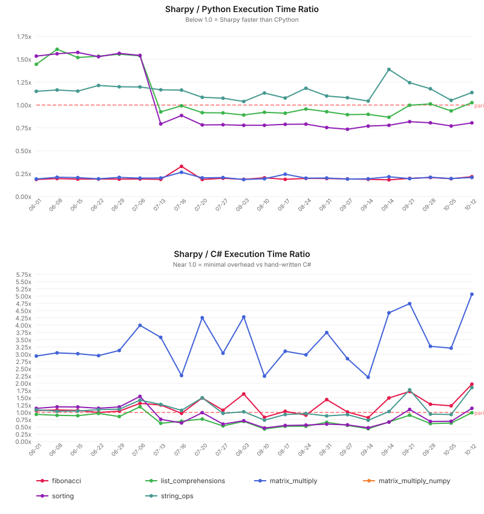

# Cross-Language Benchmark Results (2026-10-19)

**Runner:** `ubuntu-latest` | **Python:** 3.12 | **.NET:** 10.0 | **Runs:** 10 (median) + warmup | **Stats:** mean, median, stdev, p90, p99

## Execution Time (runtime only)

| Benchmark | Python | Sharpy | C# | Spy/Py | Spy/C# |
|-----------|--------|--------|-----|--------|--------|
| fibonacci | 204ms | 42ms | 27ms | 0.21x | 1.58x |
| list_comprehensions | 57ms | 55ms | 82ms | 0.97x | 0.67x |
| matrix_multiply | 749ms | 157ms | 37ms | 0.21x | 4.23x |
| matrix_multiply_numpy | FAIL | FAIL | 1.01s | — | — |
| sorting | 176ms | 146ms | 226ms | 0.83x | 0.65x |
| string_ops | 163ms | 173ms | 202ms | 1.06x | 0.86x |

## Compilation Time

| Benchmark | Python (.pyc) | Sharpy (cold) | Sharpy (warm) | Sharpy (server) | C# (dotnet build) | Spy/C# |
|-----------|---------------|---------------|---------------|-----------------|-------------------|--------|
| fibonacci | 499us | 2.32s | 1.98s | 229ms | 1.10s | 2.10x |
| list_comprehensions | 510us | 2.46s | 2.11s | 212ms | 1.11s | 2.21x |
| matrix_multiply | 682us | 2.53s | 2.17s | 243ms | 1.09s | 2.31x |
| matrix_multiply_numpy | 527us | — | — | — | 1.27s | — |
| sorting | 496us | 2.59s | 2.18s | 226ms | 1.10s | 2.36x |
| string_ops | 391us | 2.38s | 2.04s | 210ms | 1.09s | 2.18x |

## Execution Time Distribution

| Benchmark | Lang | Mean | Median | Stdev | P90 | P99 | Min | Max | N |
|-----------|------|------|--------|-------|-----|-----|-----|-----|---|
| fibonacci | Python | 204ms | 204ms | 2ms | 205ms | 207ms | 201ms | 208ms | 10 |
| fibonacci | Sharpy | 42ms | 42ms | 303us | 42ms | 42ms | 41ms | 42ms | 10 |
| fibonacci | C# | 27ms | 27ms | 780us | 28ms | 28ms | 25ms | 28ms | 10 |
| list_comprehensions | Python | 57ms | 57ms | 920us | 58ms | 58ms | 55ms | 58ms | 10 |
| list_comprehensions | Sharpy | 55ms | 55ms | 341us | 55ms | 55ms | 54ms | 55ms | 10 |
| list_comprehensions | C# | 83ms | 82ms | 4ms | 83ms | 92ms | 79ms | 93ms | 10 |
| matrix_multiply | Python | 781ms | 749ms | 61ms | 901ms | 902ms | 744ms | 902ms | 10 |
| matrix_multiply | Sharpy | 162ms | 157ms | 12ms | 182ms | 189ms | 156ms | 190ms | 10 |
| matrix_multiply | C# | 38ms | 37ms | 3ms | 39ms | 47ms | 36ms | 47ms | 10 |
| matrix_multiply_numpy | C# | 1.03s | 1.01s | 73ms | 1.12s | 1.15s | 945ms | 1.15s | 10 |
| sorting | Python | 176ms | 176ms | 1ms | 177ms | 178ms | 174ms | 178ms | 10 |
| sorting | Sharpy | 146ms | 146ms | 708us | 147ms | 147ms | 145ms | 147ms | 10 |
| sorting | C# | 228ms | 226ms | 6ms | 237ms | 241ms | 224ms | 241ms | 10 |
| string_ops | Python | 163ms | 163ms | 2ms | 166ms | 167ms | 160ms | 167ms | 10 |
| string_ops | Sharpy | 173ms | 173ms | 724us | 173ms | 174ms | 171ms | 174ms | 10 |
| string_ops | C# | 202ms | 202ms | 2ms | 204ms | 205ms | 200ms | 206ms | 10 |

## Performance Trend

> **Spy/Py < 1.0** = Sharpy execution faster than Python. **Spy/C# ≈ 1.0** = minimal overhead vs hand-written C#.

> **Sharpy (cold)** = single-file compile with no cache; **Sharpy (warm)** = `--incremental` one-file `.spyproj` compile with the symbol cache present; **Sharpy (server)** = end-to-end `sharpyc build --server` compile through a persistent keep-alive process ([#1049](https://github.com/antonsynd/sharpy/issues/1049), D2), which reuses the process-lifetime `MetadataReference`/overload-index caches across compiles.

---
*Generated by CI on 2026-10-19*
