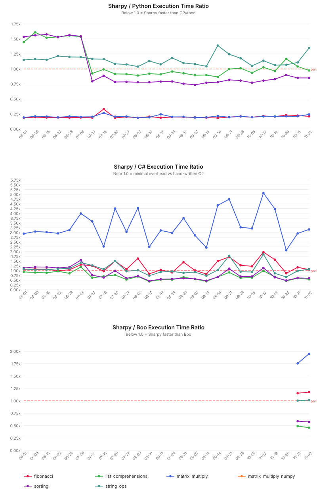

# Cross-Language Benchmark Results (2026-11-02)

**Runner:** `ubuntu-latest` | **Python:** 3.12 | **.NET:** 10.0 | **Runs:** 10 (median) + warmup | **Stats:** mean, median, stdev, p90, p99

## Execution Time (runtime only)

| Benchmark | Python | Sharpy | C# | Boo | Spy/Py | Spy/C# | Spy/Boo |
|-----------|--------|--------|-----|-----|--------|--------|---------|
| fibonacci | 191ms | 40ms | 38ms | 34ms | 0.21x | 1.05x | 1.17x |
| list_comprehensions | 54ms | 53ms | 97ms | 115ms | 0.97x | 0.54x | 0.46x |
| matrix_multiply | 671ms | 162ms | 51ms | 83ms | 0.24x | 3.16x | 1.95x |
| matrix_multiply_numpy | FAIL | FAIL | 1.40s | — | — | — | — |
| sorting | 169ms | 143ms | 239ms | 250ms | 0.85x | 0.60x | 0.57x |
| string_ops | 142ms | 191ms | 178ms | 188ms | 1.35x | 1.07x | 1.01x |

## Compilation Time

| Benchmark | Python (.pyc) | Sharpy (cold) | Sharpy (warm) | Sharpy (server) | C# (dotnet build) | Boo (booc) | Spy/C# |
|-----------|---------------|---------------|---------------|-----------------|-------------------|------------|--------|
| fibonacci | 535us | 2.09s | 1.78s | 211ms | 1.50s | 764ms | 1.39x |
| list_comprehensions | 479us | 2.23s | 1.89s | 211ms | 1.48s | 842ms | 1.51x |
| matrix_multiply | 658us | 2.29s | 1.94s | 239ms | 1.42s | 970ms | 1.61x |
| matrix_multiply_numpy | 437us | — | — | — | 1.71s | — | — |
| sorting | 492us | 2.36s | 1.98s | 228ms | 1.45s | 903ms | 1.63x |
| string_ops | 372us | 2.20s | 1.86s | 209ms | 1.46s | 751ms | 1.51x |

## Execution Time Distribution

| Benchmark | Lang | Mean | Median | Stdev | P90 | P99 | Min | Max | N |
|-----------|------|------|--------|-------|-----|-----|-----|-----|---|
| fibonacci | Python | 191ms | 191ms | 3ms | 194ms | 197ms | 189ms | 198ms | 10 |
| fibonacci | Sharpy | 40ms | 40ms | 423us | 41ms | 41ms | 39ms | 41ms | 10 |
| fibonacci | C# | 39ms | 38ms | 2ms | 39ms | 45ms | 38ms | 46ms | 10 |
| fibonacci | Boo | 34ms | 34ms | 553us | 35ms | 36ms | 34ms | 36ms | 10 |
| list_comprehensions | Python | 54ms | 54ms | 505us | 54ms | 56ms | 54ms | 56ms | 10 |
| list_comprehensions | Sharpy | 53ms | 53ms | 684us | 54ms | 54ms | 52ms | 54ms | 10 |
| list_comprehensions | C# | 97ms | 97ms | 1ms | 99ms | 99ms | 95ms | 99ms | 10 |
| list_comprehensions | Boo | 114ms | 115ms | 1ms | 116ms | 116ms | 112ms | 116ms | 10 |
| matrix_multiply | Python | 672ms | 671ms | 6ms | 678ms | 685ms | 664ms | 685ms | 10 |
| matrix_multiply | Sharpy | 163ms | 162ms | 2ms | 165ms | 169ms | 161ms | 169ms | 10 |
| matrix_multiply | C# | 52ms | 51ms | 3ms | 53ms | 61ms | 50ms | 61ms | 10 |
| matrix_multiply | Boo | 83ms | 83ms | 726us | 84ms | 84ms | 82ms | 84ms | 10 |
| matrix_multiply_numpy | C# | 1.38s | 1.40s | 119ms | 1.51s | 1.52s | 1.23s | 1.52s | 10 |
| sorting | Python | 169ms | 169ms | 2ms | 172ms | 173ms | 167ms | 173ms | 10 |
| sorting | Sharpy | 144ms | 143ms | 1ms | 145ms | 145ms | 142ms | 146ms | 10 |
| sorting | C# | 240ms | 239ms | 6ms | 248ms | 250ms | 234ms | 250ms | 10 |
| sorting | Boo | 250ms | 250ms | 1ms | 251ms | 251ms | 248ms | 251ms | 10 |
| string_ops | Python | 143ms | 142ms | 3ms | 144ms | 150ms | 141ms | 151ms | 10 |
| string_ops | Sharpy | 191ms | 191ms | 2ms | 194ms | 194ms | 189ms | 194ms | 10 |
| string_ops | C# | 178ms | 178ms | 993us | 179ms | 180ms | 177ms | 180ms | 10 |
| string_ops | Boo | 190ms | 188ms | 3ms | 194ms | 194ms | 186ms | 194ms | 10 |

## Performance Trend

> **Spy/Py < 1.0** = Sharpy execution faster than Python. **Spy/C# ≈ 1.0** = minimal overhead vs hand-written C#. **Spy/Boo < 1.0** = Sharpy faster than [Boo](https://github.com/boo-lang/boo), the other Python-flavoured statically typed .NET language (built from a pinned commit; `-debug-`, default checked arithmetic).

> **Sharpy (cold)** = single-file compile with no cache; **Sharpy (warm)** = `--incremental` one-file `.spyproj` compile with the symbol cache present; **Sharpy (server)** = end-to-end `sharpyc build --server` compile through a persistent keep-alive process ([#1049](https://github.com/antonsynd/sharpy/issues/1049), D2), which reuses the process-lifetime `MetadataReference`/overload-index caches across compiles.

---
*Generated by CI on 2026-11-02*
