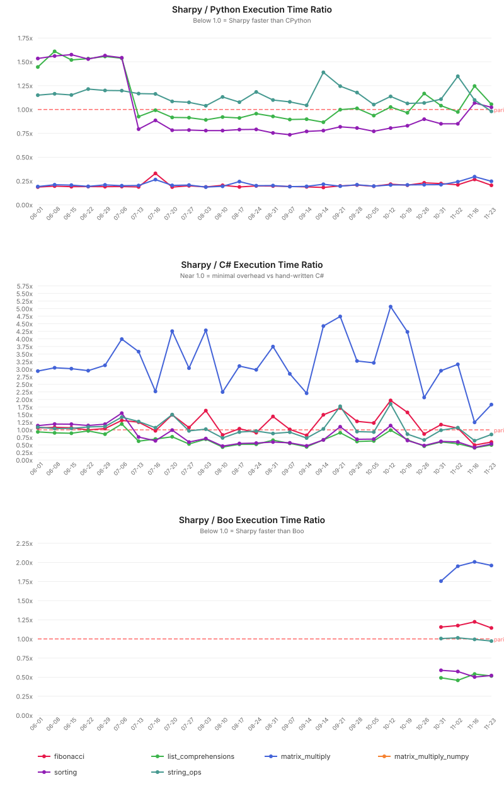

# Cross-Language Benchmark Results (2026-11-23)

**Runner:** `ubuntu-latest` | **Python:** 3.15.2 | **.NET:** 10.0 | **Runs:** 10 (median) + warmup | **Stats:** mean, median, stdev, p90, p99

## Execution Time (runtime only)

| Benchmark | Python | Sharpy | C# | Boo | Spy/Py | Spy/C# | Spy/Boo |
|-----------|--------|--------|-----|-----|--------|--------|---------|
| fibonacci | 178ms | 37ms | 61ms | 32ms | 0.20x | 0.60x | 1.14x |
| list_comprehensions | 48ms | 51ms | 101ms | 99ms | 1.05x | 0.50x | 0.51x |
| matrix_multiply | 575ms | 142ms | 77ms | 73ms | 0.25x | 1.83x | 1.96x |
| matrix_multiply_numpy | FAIL | FAIL | 1.48s | — | — | — | — |
| sorting | 122ms | 125ms | 233ms | 240ms | 1.02x | 0.54x | 0.52x |
| string_ops | 155ms | 152ms | 179ms | 156ms | 0.98x | 0.85x | 0.97x |

## Compilation Time

| Benchmark | Python (.pyc) | Sharpy (cold) | Sharpy (warm) | Sharpy (server) | C# (dotnet build) | Boo (booc) | Spy/C# |
|-----------|---------------|---------------|---------------|-----------------|-------------------|------------|--------|
| fibonacci | 537us | 1.83s | 173ms | 182ms | 916ms | 642ms | 1.99x |
| list_comprehensions | 457us | 1.99s | 173ms | 197ms | 1.03s | 722ms | 1.93x |
| matrix_multiply | 642us | 2.04s | 175ms | 209ms | 887ms | 828ms | 2.30x |
| matrix_multiply_numpy | 501us | — | — | — | 909ms | — | — |
| sorting | 535us | 2.21s | 190ms | 211ms | 952ms | 763ms | 2.32x |
| string_ops | 380us | 2.01s | 188ms | 193ms | 839ms | 648ms | 2.39x |

## Execution Time Distribution

| Benchmark | Lang | Mean | Median | Stdev | P90 | P99 | Min | Max | N |
|-----------|------|------|--------|-------|-----|-----|-----|-----|---|
| fibonacci | Python | 178ms | 178ms | 4ms | 182ms | 182ms | 171ms | 182ms | 10 |
| fibonacci | Sharpy | 37ms | 37ms | 1ms | 37ms | 40ms | 36ms | 40ms | 10 |
| fibonacci | C# | 61ms | 61ms | 802us | 62ms | 63ms | 60ms | 63ms | 10 |
| fibonacci | Boo | 32ms | 32ms | 1ms | 33ms | 36ms | 32ms | 36ms | 10 |
| list_comprehensions | Python | 48ms | 48ms | 620us | 49ms | 50ms | 47ms | 50ms | 10 |
| list_comprehensions | Sharpy | 51ms | 51ms | 516us | 52ms | 52ms | 50ms | 52ms | 10 |
| list_comprehensions | C# | 103ms | 101ms | 5ms | 105ms | 117ms | 100ms | 119ms | 10 |
| list_comprehensions | Boo | 99ms | 99ms | 2ms | 102ms | 102ms | 96ms | 102ms | 10 |
| matrix_multiply | Python | 574ms | 575ms | 12ms | 587ms | 595ms | 557ms | 596ms | 10 |
| matrix_multiply | Sharpy | 142ms | 142ms | 1ms | 143ms | 146ms | 142ms | 146ms | 10 |
| matrix_multiply | C# | 71ms | 77ms | 15ms | 86ms | 86ms | 53ms | 86ms | 10 |
| matrix_multiply | Boo | 73ms | 73ms | 231us | 73ms | 73ms | 72ms | 73ms | 10 |
| matrix_multiply_numpy | C# | 1.49s | 1.48s | 82ms | 1.59s | 1.61s | 1.33s | 1.62s | 10 |
| sorting | Python | 122ms | 122ms | 2ms | 123ms | 124ms | 118ms | 124ms | 10 |
| sorting | Sharpy | 125ms | 125ms | 853us | 126ms | 126ms | 123ms | 126ms | 10 |
| sorting | C# | 241ms | 233ms | 22ms | 247ms | 301ms | 228ms | 307ms | 10 |
| sorting | Boo | 239ms | 240ms | 1ms | 240ms | 241ms | 238ms | 241ms | 10 |
| string_ops | Python | 154ms | 155ms | 3ms | 157ms | 158ms | 147ms | 158ms | 10 |
| string_ops | Sharpy | 152ms | 152ms | 2ms | 154ms | 155ms | 150ms | 155ms | 10 |
| string_ops | C# | 179ms | 179ms | 2ms | 182ms | 182ms | 175ms | 182ms | 10 |
| string_ops | Boo | 156ms | 156ms | 3ms | 160ms | 160ms | 151ms | 160ms | 10 |

## Performance Trend

> **Spy/Py < 1.0** = Sharpy execution faster than Python. **Spy/C# ≈ 1.0** = minimal overhead vs hand-written C#. **Spy/Boo < 1.0** = Sharpy faster than [Boo](https://github.com/boo-lang/boo), the other Python-flavoured statically typed .NET language (built from a pinned commit; `-debug-`, default checked arithmetic).

> **Sharpy (cold)** = single-file compile with no cache; **Sharpy (warm)** = `--incremental` one-file `.spyproj` compile with the symbol cache present; **Sharpy (server)** = end-to-end `sharpyc build --server` compile through a persistent keep-alive process ([#1049](https://github.com/antonsynd/sharpy/issues/1049), D2), which reuses the process-lifetime `MetadataReference`/overload-index caches across compiles.

---
*Generated by CI on 2026-11-23*
